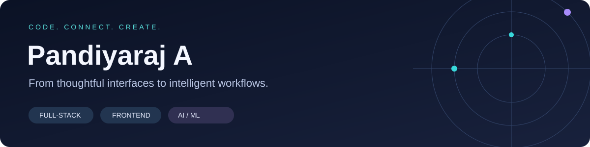

# Hi, I'm Pandiyaraj A

### Full-stack · Frontend · Backend · AI/ML · Data Analysis

I build end-to-end web applications, from frontend interfaces and backend APIs to machine-learning models and data dashboards. My work also includes NLP, RAG, LLM integrations, and Power BI.

[Portfolio](https://pandiyaraj.netlify.app/) · [LinkedIn](https://www.linkedin.com/in/pandiyaraj-a-mca/) · [Resume](https://github.com/Pandiyaraj2004/MY-NEW-PORTFOLIO/blob/main/public/assets/Pandiyaraj_A_Resume.pdf) · [Email](mailto:pandiyaraja409@gmail.com)

**MCA graduate · Open to full-stack, frontend, backend, AI/ML, and data roles**

---

## From interface to implementation

I work across React interfaces, Node.js and Python backends, APIs, databases, model training and inference, and data visualization. I also have experience with NLP projects, retrieval-augmented generation (RAG), LLM-based features, data analysis, and Power BI dashboards.

## Selected work

| Project | What it explores | Explore |
| --- | --- | --- |
| **PayLink** | Merchant storefronts and payment workflows with a React/TypeScript frontend and Express backend | [Code & guide](https://github.com/Pandiyaraj2004/Paylink) |
| **VidPilot AI** | Script-to-video orchestration, narration, rendering, quality checks, and publishing workflows | [Code & guide](https://github.com/Pandiyaraj2004/VidPilot-AI) |
| **Parithi** | Language design, parsing, semantic analysis, bytecode, a virtual machine, and a limited native backend | [Code & guide](https://github.com/Pandiyaraj2004/Parithi-Programming-Language) |
| **Gowtham Events** | Interactive 3D storytelling alongside admin, client, and partner interfaces | [Code & guide](https://github.com/Pandiyaraj2004/Gowtham-events) |
| **LiquiFlow** | Risk rules, reserve allocation, and merchant/admin treasury workflows in a demonstration application | [Code & guide](https://github.com/Pandiyaraj2004/liquiflow_new) |
| **Smart Crop Disease Identification** | Crop-specific image preprocessing and Keras inference; model setup requirements documented | [Code & guide](https://github.com/Pandiyaraj2004/smart-crop-Disease-Identification) |
| **NLP Chatbot** | Tokenization, stemming, intent matching, and data-driven responses | [Code & guide](https://github.com/Pandiyaraj2004/Real-time-chatbot-using-NLP) |
| **Multiple Disease Prediction** | Saved tabular and image models served through a Flask application | [Code & guide](https://github.com/Pandiyaraj2004/Multiple-Disease-Prediction-using-Machine_Learning) |

## Find the work relevant to your team

**Full-stack:** [PayLink](https://github.com/Pandiyaraj2004/Paylink), [LiquiFlow](https://github.com/Pandiyaraj2004/liquiflow_new), [PayForesight](https://github.com/Pandiyaraj2004/PayForesight), and [ServiConnect](https://github.com/Pandiyaraj2004/serviconnect).

**Frontend:** [Gowtham Events](https://github.com/Pandiyaraj2004/Gowtham-events), my [React + Three.js portfolio](https://github.com/Pandiyaraj2004/MY-NEW-PORTFOLIO), and [Virtual Balloon Pop](https://github.com/Pandiyaraj2004/bollon-pop-game_pandi).

**AI / ML model building:** [Crop image classification](https://github.com/Pandiyaraj2004/smart-crop-Disease-Identification), [multiple disease prediction](https://github.com/Pandiyaraj2004/Multiple-Disease-Prediction-using-Machine_Learning), and [OpenCV object detection](https://github.com/Pandiyaraj2004/object_detection).

**NLP and LLMs:** [NLP chatbot](https://github.com/Pandiyaraj2004/Real-time-chatbot-using-NLP) and [VidPilot AI](https://github.com/Pandiyaraj2004/VidPilot-AI). I also have experience with RAG workflows and LLM integrations; the linked chatbot is an intent-matching project, not a RAG implementation.

**Data analysis:** Python, SQL, Excel, and Power BI for exploring data and communicating results.

## Tools across my projects

| Area | Technologies |
| --- | --- |
| Languages | JavaScript, TypeScript, Python, SQL |
| Frontend | React, Next.js, HTML, CSS, Tailwind CSS, Three.js, Framer Motion |
| Backend & data | Node.js, Express, Flask, Firebase, PostgreSQL, MySQL, Redis |
| AI, ML & NLP | TensorFlow/Keras, scikit-learn, OpenCV, NLTK, RAG, LLM integrations |
| Data analysis & visualization | Python, SQL, Pandas, NumPy, Excel, Power BI |
| Engineering | Git, API design, Jest/Vitest, compiler pipelines, background processing |

## A little beyond web apps

I am also building **Parithi**, exploring how readable source code becomes executable behavior. Its repositories include examples, compiler stages, and tests:

- [Language, interpreter & VM](https://github.com/Pandiyaraj2004/Parithi-Programming-Language)
- [Native compiler project](https://github.com/Pandiyaraj2004/parithi_pro)

---

### Let's build something useful

I'm interested in roles where I can contribute across the stack, build and integrate AI/ML systems, or turn data into useful insights.

**[Explore my portfolio](https://pandiyaraj.netlify.app/) · [Get in touch](mailto:pandiyaraja409@gmail.com)**
